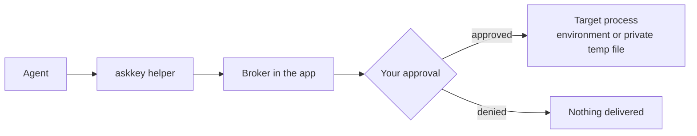

<p align="center">
  
</p>

<h1 align="center">Ask Key for Windows</h1>

<p align="center"><strong>A local credential manager for AI agents on Windows.</strong></p>

<p align="center">
  <a href="README.zh-CN.md">简体中文</a> · <a href="README.md">English</a>
</p>

Ask Key keeps credentials encrypted on your PC. Agents discover credentials by name and metadata, then ask the local Broker for access. You decide whether a request may proceed. Approved text values are delivered as environment variables to the target process, and file values as short-lived private files. Ask Key does not return stored plaintext directly to the Agent; an approved target process receives the value and can, like any process you run, copy or forward it.

This repository contains the Windows implementation only. The app is a WinUI 3 / .NET application, and the release tooling is also .NET.

> **macOS upstream:** The original macOS app and shared product/security documentation live at [sudoHG/AskKey](https://github.com/sudoHG/AskKey). This repository does not vendor the macOS source tree. This is an unofficial Windows port; the upstream project is not responsible for this build.

## What it does

- **Find keys:** agents can look up credential names, usage notes and variable mappings without receiving the values.
- **Control access:** use **Allow**, **Ask every time** or **Hidden** for each credential.
- **Review writes:** creating, changing, deleting and reorganizing credentials can require approval. The approval is bound to the exact frozen contents shown to you.
- **Keep values local:** revealing or copying a stored value and viewing frozen approval contents require fresh Windows Hello or PIN confirmation. Ordinary management actions reuse the configured 5- or 15-minute session.
- **Protect the approval screen:** detailed approvals are dismissed when the session locks, disconnects or logs off, then restored when the session returns.
- **Start quickly:** use presets for API access, SSH, GitHub Apps, cloud accounts and database connections.

## How it works



The helper runs the target command with only the credentials selected for that request. The Broker enforces the credential permission and owns the approval queue. The Agent sees the target's output or exit status, not the stored credential values.

## Repository layout

| Path | Purpose |
|---|---|
| `src\AskKey.WinUI` | WinUI 3 desktop app, tray menu, onboarding and settings |
| `src\AskKey.Broker` | Local approval, policy and delivery broker |
| `src\AskKey.Vault` | Encrypted credential store and key management |
| `src\AskKey.Helper` | `askkey.exe` MCP helper and command wrapper |
| `src\AskKey.Integrations` | Codex, Claude Code, Cursor and Grok client setup |
| `src\AskKey.System` | Restricted process and Windows runtime integration |
| `src\*.Tests` | Unit and integration tests |
| `src\AskKey.Build` | .NET release tool: helper manifest, build, signing and Velopack packaging |
| `src\installer` | WiX bundle, Guard MSI and installer text |

## Requirements

- Windows 10 2004 or later, or Windows 11.
- x64.
- .NET 10 SDK for building and testing. Published packages are self-contained.
- Windows Hello or a PIN for management and credential-reveal operations.

## Build and test

Run these commands from the repository root:

```text
dotnet test .\AskKey.slnx
dotnet run --project .\src\AskKey.WinUI\AskKey.WinUI.csproj -p:Platform=x64
```

Debug builds do not set any environment variable automatically. To use separate development data roots, set `ASKKEY_DEVELOPMENT=1` before launching; otherwise a Debug build uses the normal `%APPDATA%\AskKey` and `%LOCALAPPDATA%\AskKey` paths.

## Publish

The release tool is a .NET project, not a PowerShell script:

```text
dotnet run --project .\src\AskKey.Build -- publish
```

To sign the host and helper with a certificate from the current user's certificate store:

```text
dotnet run --project .\src\AskKey.Build -- publish --certificate-thumbprint <thumbprint>
```

The tool reads the version from `src\AskKey.Integrations\AskKeyVersion.cs`, runs the tests, builds the self-contained x64 payload, verifies `AskKey.exe` and `Helpers\askkey.exe`, trims satellite resources to `zh-CN`, signs when requested, runs `vpk pack`, publishes the Guard service, builds the Guard MSI, and finally produces `AskKeySetup-<version>.exe` with both the app and Guard.

The default output is `artifacts\publish\release`:

- `AskKeySetup-<version>.exe` — **recommended installer**, one UAC prompt for the app and Guard
- `AskKey-win.msi` — app only, per-machine install in `%ProgramFiles%\AskKey\current\`
- `AskKeyGuard-<version>.msi` — Guard only, for repair or advanced deployment
- `AskKey-<version>.sha256` — SHA-256 of every other asset

The build also produces `AskKey-win-Setup.exe` (per-user install without Guard) and `AskKey-win-Portable.zip`. Do not publish either: the per-user layout is a weaker security boundary, and the topology gate rejects a portable copy once it has been moved.

Upload these assets to a GitHub release:

- `AskKeySetup-<version>.exe`
- `AskKey-win.msi`
- `AskKeyGuard-<version>.msi`
- `AskKey-<version>.sha256`
- `AskKey-<version>-full.nupkg`
- `releases.win.json`, `assets.win.json`, `RELEASES`

The first four are for people who install by hand. The last four are the Velopack update feed: an installed build reads them from the GitHub release, so without them the in-app **Check for updates** button can never find a newer version. Do not hand-edit the feed files.

### Windows Hello Guard service

Normal installation uses `AskKeySetup-<version>.exe`: it installs the app first, then Guard, and removes both when uninstalled from Apps & Features. Run a newer setup over an existing install to upgrade — the app and Guard MSIs keep a stable UpgradeCode, so Windows Installer replaces them in place. Uninstall first only when moving from the old per-user layout. The two standalone MSIs are for repair or advanced deployment; manually install the app first and `AskKeyGuard-<version>.msi` second, and uninstall Guard first. The per-user `AskKey-win-Setup.exe` cannot use Hello unlock.

For development, publish the service separately:

```text
dotnet run --project .\src\AskKey.Build -- guard
```

`src\AskKey.Guard.Service\Install-GuardService.ps1` is the repair/development path; `src\installer\Guard\build-guard-msi.ps1 -Unsigned` builds the unsigned Guard MSI. After both MSIs exist, `dotnet run --project .\src\AskKey.Build -- bundle` regenerates `AskKeySetup`. See `docs/guard-msi.md`. A production release still needs code signing.

Unsigned builds embed a SHA-256 manifest of the `Helpers\` payload and verify it before Agent connections. Windows SmartScreen still warns for unsigned downloads. Signed builds require the host and helper to carry signatures from the same publisher.

## Install

| Installer | Scope | Location | Elevation |
|---|---|---|---|
| `AskKeySetup-<version>.exe` | Per-machine, app + Guard | `%ProgramFiles%\AskKey\current\` + `%ProgramFiles%\AskKey\Guard\` | Yes (UAC) |
| `AskKey-win.msi` + `AskKeyGuard-<version>.msi` | Per-machine, split/repair | Same as above | Yes (UAC) |
| `AskKey-win-Setup.exe` | Per-user, no Guard | `%LocalAppData%\AskKey\current\` | No |

Download `AskKeySetup-<version>.exe` from [Releases](https://github.com/A1mAssist/AskKey/releases) and run it for normal installation. Uninstalling it from Apps & Features removes both the app and Guard. Use the split MSIs only for repair or advanced deployment: install the app first and Guard second; uninstall Guard first.

Verify the download before running it. Releases ship `AskKey-<version>.sha256`, which the release tool generates at build time:

```powershell
Get-FileHash -Algorithm SHA256 .\AskKeySetup-1.0.0.exe
```

Compare the result with the matching line in `AskKey-1.0.0.sha256`. The file is also where you get the checksum for the MSIs.

The installer extracts the payload behind a `current\` folder:

```text
<install root>\current\AskKey.exe
<install root>\current\Helpers\askkey.exe
```

Credentials and key material live under `%APPDATA%\AskKey`. Settings and the Broker pipe live under `%LOCALAPPDATA%\AskKey`. Removing the install folder does not delete the credential library.

Uninstalling leaves two things behind on purpose:

- `%ProgramData%\AskKey\Guard` holds the Guard service's DPAPI master key and per-account Windows Hello enrollments. Deleting it would permanently break Windows Hello unlock for every enrolled account, so the component is Permanent. See [docs/guard-service.md](docs/guard-service.md#uninstall-residue).
- `%LOCALAPPDATA%\Microsoft\WindowsAppSDK\velopack.AskKey.png` is the taskbar icon bitmap for the unpackaged app.

There is no automatic migration from the old per-user install to the per-machine one; no released build has shipped that layout. Uninstall the per-user build before installing `AskKeySetup-<version>.exe`, or the two installs will both appear in Apps & Features.

## Agent access

The app includes setup for Claude Code, Codex, Cursor and Grok CLI. Open **Agent access** in the app, check the client and confirm. Setup adds Ask Key as an MCP server, keeps the existing client settings, and verifies the helper and Broker before reporting the client as connected.

Any MCP stdio client can be configured manually with the installed helper:

```json
{
  "command": "C:\\Users\\<you>\\AppData\\Local\\AskKey\\current\\Helpers\\askkey.exe",
  "args": ["mcp"]
}
```

For a per-machine install, use `C:\\Program Files\\AskKey\\current\\Helpers\\askkey.exe` instead. Manual setup does not install discovery hooks or run the in-app connection check. Broker permissions, approval prompts and credential delivery protections still apply.

## Security model

The Agent is treated as only partly trusted: it may run commands as your Windows user, but it must not receive a stored value without the approval flow.

- **Default mode** wraps the vault key with Windows DPAPI (`CurrentUser`). This protects the files at rest, but any process running as you can unwrap the same key.
- **High security mode** wraps the vault key with a passphrase using PBKDF2-HMAC-SHA256 (600,000 iterations) and deletes the DPAPI copy. If the per-machine AskKey Guard service is installed, the passphrase unlocks the first launch and later starts can use Windows Hello; the passphrase remains the recovery path. Without the service, Ask Key asks for the passphrase every time. Enabling this mode re-wraps the existing key; it does not rotate the key, so a key or DPAPI copy obtained before the switch remains usable if it still exists outside Ask Key. The passphrase cannot be recovered.
- Revealing or copying a stored value requires device confirmation. After one Windows Hello confirmation, the configured unlock window (5–60 minutes) covers further in-app management actions.
- **Fresh authentication:** revealing or copying a value, viewing frozen approval contents, approving Agent read/write requests, granting **Allow** to a credential, and erasing local data require a fresh Windows Hello or PIN confirmation even inside a management session. Ordinary management actions reuse the configured 5- or 15-minute session. Screen lock, disconnect, and logoff end that session.
- **Process-memory boundary:** while the vault is unlocked, the vault key is resident in the Ask Key process. `Lock()` zeroizes it, but a screen lock does not lock the vault because the Broker must continue serving approvals. A process running as the same Windows user can read process memory; this is a limitation of both key modes.
- **Install and integrity:** a Release build is unsigned unless a signing certificate is supplied. The unsigned build trusts the embedded helper manifest rooted in the host assembly, so same-user write access to the install folder remains a boundary. The per-machine MSI under Program Files removes the easy write path; a certificate is required for a stronger code-identity boundary. Signed builds require the host and helper to use the same publisher.
- The helper must sit beside the host inside an official install root; a relocated copy is refused.
- Caller names and purposes are self-reported declarations, not authenticated identity. An approved target process can copy or forward anything delivered to it. **Hidden** credentials are omitted from the catalog, but this does not stop a command that already received a value from forwarding it.
- Ask Key has no backup or recovery feature. Keep the originals of your credentials somewhere else.

Live Windows Hello prompts, session lock/unlock, Authenticode signing and hardware-specific behavior must be verified on the target machine; unit tests do not establish those.

## License

MIT. See [LICENSE](LICENSE) and [NOTICE](NOTICE).
