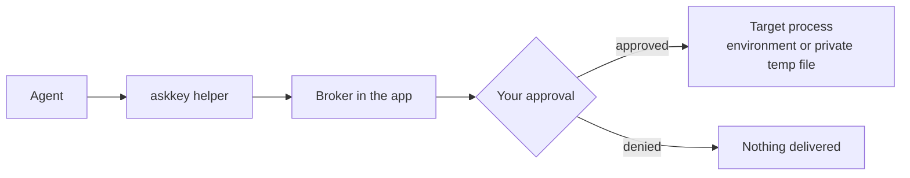

# Ask Key for Windows

**A local credential manager for AI agents on Windows.**

This repository contains the Windows port of [Ask Key](https://github.com/sudoHG/AskKey), the macOS app. The macOS source and its original product documentation remain upstream; the Windows implementation lives in [`windows/`](windows/).

Ask Key keeps credentials encrypted on your PC. Agents discover credentials by name and metadata, then ask the local Broker for access. You decide whether a request may proceed. Approved text values are delivered as environment variables to the target process, and file values as short-lived private files. The agent never receives the stored plaintext.

> The macOS app is maintained separately at [sudoHG/AskKey](https://github.com/sudoHG/AskKey). This repository is intended for Windows development and packaging.

## What it does

- **Find keys:** agents can look up credential names, usage notes and variable mappings without receiving the values.
- **Control access:** use **Allow**, **Ask every time** or **Hidden** for each credential.
- **Review writes:** creating, changing, deleting and reorganizing credentials can require approval. The approval is bound to the exact frozen contents shown to you.
- **Keep values local:** Windows Hello or your PIN is required to reveal management values and frozen file contents.
- **Protect the approval screen:** detailed approvals are dismissed when the session locks, disconnects or logs off, then restored when the session returns.
- **Start quickly:** use presets for API access, SSH, GitHub Apps, Apple signing, cloud accounts and database connections.

## How it works



The helper runs the target command with only the credentials selected for that request. The Broker enforces the credential permission and owns the approval queue. The Agent sees the target's output or exit status, not the stored credential values.

## Requirements

- Windows 10 2004 or later, or Windows 11.
- x64 by default; the publish script also accepts `win-arm64`.
- The .NET 10 SDK for building and testing. Published packages are self-contained.
- Windows Hello or a PIN for management and credential-reveal operations.

## Build and run

Run these commands from the repository root:

```powershell
dotnet test .\windows\AskKey.slnx
dotnet run --project .\windows\AskKey.App\AskKey.App.csproj
```

Debug builds use `ASKKEY_DEVELOPMENT=1` and separate development data roots, so they do not touch a normally installed vault.

The Windows-specific build, test and packaging details are in [`windows/README.md`](windows/README.md).

## Publish

Create a self-contained Windows package, verify its layout, and generate a ZIP with a SHA-256 file:

```powershell
.\windows\publish-windows.ps1
```

To sign the host and helper with a certificate from the current user's certificate store:

```powershell
.\windows\publish-windows.ps1 -CertificateThumbprint <thumbprint>
```

Signed builds require both executables to be Authenticode-signed by the same publisher. Without a certificate, the unsigned build embeds a SHA-256 manifest of the complete `Helpers\` payload and verifies it before Agent connections, so automatic setup still works; Windows SmartScreen still warns.

## Install

1. Quit Ask Key from the tray before replacing files.
2. Extract the package into `%LOCALAPPDATA%\AskKey`.
3. The expected layout is:

   ```text
   %LOCALAPPDATA%\AskKey\AskKey.exe
   %LOCALAPPDATA%\AskKey\Helpers\askkey.exe
   %LOCALAPPDATA%\AskKey\Helpers\hostfxr.dll
   ```

4. Launch `%LOCALAPPDATA%\AskKey\AskKey.exe`.

The official helper topology requires that install location. Running the application from a download folder is intended for development only.

There is currently no installer or automatic updater. Credentials live under `%APPDATA%\AskKey`; settings, delivery files and the installed application live under `%LOCALAPPDATA%\AskKey`. Removing the install folder does not delete your credential library.

## Agent access

The Windows app includes setup for Claude Code, Codex, Cursor and Grok CLI. Open **Agent access** in the app, check the client and confirm. Setup adds Ask Key as an MCP server, keeps the existing client settings, and verifies the helper and Broker before reporting the client as connected.

Any MCP stdio client can be configured manually with:

```json
{
  "command": "C:\\Users\\<you>\\AppData\\Local\\AskKey\\Helpers\\askkey.exe",
  "args": ["mcp"]
}
```

Manual setup does not install discovery hooks or run the in-app connection check. Broker permissions, approval prompts and credential delivery protections still apply.

## Security model

- Credentials are encrypted locally. Management, MCP and helper responses do not return stored plaintext.
- Revealing or copying a stored value requires fresh system authentication.
- Revoking, expiring or pausing prevents deliveries that have not started and cleans up temporary files.
- Caller names and purposes are declared by the Agent. They help you understand a request; they are not verified identity.
- An approved target can print, copy or forward the material it receives. Hidden keeps a credential out of the Agent catalog, but does not protect against another process running as the same Windows user.
- Ask Key has no backup or recovery feature. Keep the originals of your credentials somewhere else.

The macOS implementation and its security documentation are maintained upstream. See the upstream [security policy](https://github.com/sudoHG/AskKey/blob/main/SECURITY.md) for the original threat model and reporting guidance.

## Relationship to upstream

Ask Key began as a fork of [Lokalite](https://github.com/RubenGlez/lokalite) by Ruben Gonzalez Alonso. The product and most of the code have since been rewritten. The macOS app remains the upstream reference for shared behavior and product documentation:

- Upstream repository: <https://github.com/sudoHG/AskKey>
- This repository: Windows implementation and release tooling
- Windows setup and publish details: [`windows/README.md`](windows/README.md)

The original macOS source tree is not included in this repository. A local checkout may be kept outside Git for comparison during development.

## License

MIT. See [LICENSE](LICENSE) and [NOTICE](NOTICE).
