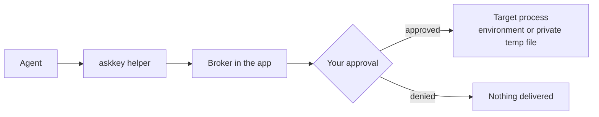

<p align="center">
  
</p>

<h1 align="center">Ask Key for Windows</h1>

<p align="center"><strong>A local credential manager for AI agents on Windows.</strong></p>

<p align="center">
  <a href="README.zh-CN.md">简体中文</a> · <a href="README.md">English</a>
</p>

Ask Key keeps credentials encrypted on your PC. Agents discover them by name and metadata, then ask a local Broker for access — you decide whether a request may proceed. Approved text values reach the target process as environment variables, and file values as short-lived private files.

Ask Key never hands stored plaintext back to the Agent. The approved process receives the value and can, like any process you run, copy or forward it.

Windows 10 2004 or later, or Windows 11, x64. MIT licensed. The build is unsigned, so SmartScreen will warn.

> **macOS upstream:** the original macOS app and the shared product/security documentation live at [sudoHG/AskKey](https://github.com/sudoHG/AskKey). This repository is an unofficial Windows port and contains no macOS source; the upstream project is not responsible for this build.

## Install

Download `AskKeySetup-<version>.exe` from [Releases](https://github.com/A1mAssist/AskKey/releases) and run it. One UAC prompt installs the app and the Windows Hello Guard service into `%ProgramFiles%\AskKey`.

Verify the download first. Every release ships `AskKey-<version>.sha256`:

```powershell
Get-FileHash -Algorithm SHA256 .\AskKeySetup-1.0.3.exe
```

Compare it with the matching line in `AskKey-1.0.3.sha256`. The MSI checksums are in the same file.

To upgrade, run the newer setup over the existing install. Windows Installer replaces both packages in place and your credentials are untouched.

**Advanced installs.** `AskKey-win.msi` installs the app only and `AskKeyGuard-<version>.msi` the Guard service — for repair or scripted deployment, app first then Guard, uninstall in reverse. The per-user `AskKey-win-Setup.exe` in the build output is not published: without Guard it cannot use Windows Hello unlock.

## First run

Ask Key asks you to set a passphrase (on by default) and enrolls Windows Hello when the Guard service is available. The passphrase is the recovery path — store it somewhere safe, because there is no reset.

After that Ask Key starts with Windows and stays in the tray without opening a window. Left-click the tray icon to open it. When an Agent asks for a credential while the vault is locked, Ask Key brings its unlock screen to the front instead of failing silently.

Once you unlock, read approvals inside the session window you chose in Settings (5, 15, 30 or 60 minutes) do not ask again. A write approval always does: it hands an Agent plaintext or grants a lasting permission.

## Connect an agent

The app configures Claude Code, Codex, Cursor and Grok CLI for you: open **Agent access**, tick the client, confirm. It adds Ask Key as an MCP server, keeps your existing client settings, and checks the helper and Broker before reporting the client as connected.

Any MCP stdio client works manually:

```json
{
  "command": "C:\\Program Files\\AskKey\\current\\Helpers\\askkey.exe",
  "args": ["mcp"]
}
```

Manual setup skips the discovery hooks and the in-app connection check. Broker permissions, approvals and delivery protections still apply.

## What it does

- **Find keys:** agents look up names, usage notes and variable mappings without receiving values.
- **Control access:** **Allow**, **Ask every time** or **Hidden** per credential.
- **Review writes:** creating, changing, deleting and reorganizing can require approval, bound to the exact frozen contents you were shown.
- **Keep values local:** revealing or copying a value, and viewing frozen approval contents, need a fresh Windows Hello or PIN confirmation. Ordinary management reuses the session.
- **Protect the approval screen:** detailed approvals are dismissed when the session locks, disconnects or logs off, then restored.
- **Start quickly:** presets for API access, SSH, GitHub Apps, cloud accounts and database connections.

## How it works



The helper runs the target command with only the credentials selected for that request. The Broker enforces permissions and owns the approval queue. The Agent sees the target's output or exit status, never the stored values.

## Security model

The Agent is only partly trusted: it runs commands as your Windows user, but it must not receive a stored value without the approval flow.

- **High security mode** wraps the vault key with your passphrase (PBKDF2-HMAC-SHA256, 600,000 iterations) and deletes the DPAPI copy. The per-machine Guard service lets Windows Hello unlock later starts; the passphrase remains the recovery path. Enabling it re-wraps the existing key rather than rotating it, so a copy obtained before the switch stays usable if it still exists outside Ask Key. Forgetting the passphrase means losing the vault.
- **Default mode** wraps the vault key with Windows DPAPI (`CurrentUser`). This protects files at rest, but any process running as you can unwrap the same key.
- **Fresh authentication** is required to reveal or copy a value, view frozen approval contents, approve a write request, grant **Allow** to a credential, and erase local data — even inside a management session. Screen lock, disconnect and logoff end the session.
- **Process memory:** a locked vault zeroizes the key, but a screen lock does not lock the vault, because the Broker must keep serving approvals. Processes running as you can read process memory; this holds in both key modes.
- **Integrity:** releases are unsigned, so Windows relies on the embedded helper manifest and on keeping the install folder writable only by administrators. A signing certificate is what buys a real code-identity boundary; a signed build must sign the host and helper with the same publisher.
- The helper must sit beside the host in an official install root; a relocated copy is refused.
- Caller names and purposes are self-reported. An approved process can copy or forward anything it received. **Hidden** credentials stay out of the catalog, but that does not stop a command that already has a value.
- There is no backup or recovery feature. Keep the originals elsewhere.

## Uninstall

Uninstalling from Apps & Features removes the app and the Guard service. Three things stay behind on purpose:

- `%APPDATA%\AskKey` — your encrypted credential library. Deleting it loses every credential.
- `%ProgramData%\AskKey\Guard` — the service's DPAPI master key and per-account Hello enrollments. Deleting it permanently breaks Hello unlock for every enrolled account. See [docs/guard-service.md](docs/guard-service.md).
- `%LOCALAPPDATA%\Microsoft\WindowsAppSDK\velopack.AskKey.png` — the taskbar icon bitmap for the unpackaged app.

Settings and the Broker pipe live in `%LOCALAPPDATA%\AskKey`.

## Build from source

Build, test, packaging and release steps live in [docs/development.md](docs/development.md).

## License

MIT. See [LICENSE](LICENSE) and [NOTICE](NOTICE).
