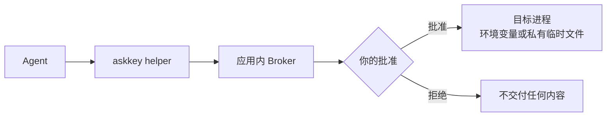

<p align="center">
  
</p>

<h1 align="center">Ask Key for Windows</h1>

<p align="center"><strong>面向 AI Agent 的 Windows 本地凭证管理器。</strong></p>

<p align="center">
  <a href="README.zh-CN.md">简体中文</a> · <a href="README.md">English</a>
</p>

Ask Key 把凭证加密保存在本机。Agent 只能按名称和元数据发现凭证，然后向本地 Broker 请求访问；是否放行由你决定。获批的文本值会作为环境变量传给目标进程，文件值会作为短期私有文件交付，Agent 始终拿不到库里的明文。

本仓库只包含 Windows 实现。发布工具使用 .NET，不包含 PowerShell 脚本。

> **macOS 上游：** 原始 macOS 应用及共享的产品/安全文档维护在 [sudoHG/AskKey](https://github.com/sudoHG/AskKey)。本仓库不包含 macOS 源码。

## 功能

- **查找凭证：** Agent 可以查询凭证名称、用途说明和变量映射，但拿不到值。
- **控制访问：** 每条凭证可以设为 **允许**、**每次询问** 或 **隐藏**。
- **审核写入：** 新建、修改、删除和整理凭证都可以要求批准；批准绑定到你看到的那份冻结内容。
- **值不出本机：** 查看管理值、查看冻结文件内容前，需要 Windows Hello 或 PIN。
- **保护审批界面：** 会话锁定、断开或注销时，详细审批会自动收起，恢复后再显示。
- **快速创建：** 内置 API、SSH、GitHub App、云账号和数据库连接模板。

## 工作方式



Helper 只把本次请求选中的凭证交给目标命令。Broker 负责权限判断和审批队列。Agent 只能看到目标进程的输出或退出状态，看不到库里的凭证值。

## 仓库结构

| 路径 | 用途 |
|---|---|
| `AskKey.WinUI` | WinUI 3 桌面应用、托盘菜单、OOBE 和设置 |
| `AskKey.Broker` | 本地审批、策略和交付 Broker |
| `AskKey.Vault` | 加密凭证库和密钥管理 |
| `AskKey.Helper` | `askkey.exe` MCP Helper 和命令包装器 |
| `AskKey.Integrations` | Codex、Claude Code、Cursor、Grok 客户端接入 |
| `AskKey.System` | 受限进程和 Windows 运行时集成 |
| `*.Tests` | 单元测试和集成测试 |
| `tools/AskKey.Build` | .NET 发布工具：Helper 清单、构建、签名和 Velopack 打包 |

## 环境要求

- Windows 10 2004 或更高版本，或 Windows 11。
- x64。
- 构建和测试需要 .NET 10 SDK；发布包自带运行时。
- 管理操作和查看凭证值需要 Windows Hello 或 PIN。

## 构建与测试

在仓库根目录执行：

```text
dotnet test .\AskKey.slnx
dotnet run --project .\AskKey.WinUI\AskKey.WinUI.csproj -p:Platform=x64
```

调试构建使用 `ASKKEY_DEVELOPMENT=1` 和独立的开发数据目录，不会碰到正常安装的凭证库。

## 发布

发布工具是 .NET 项目，不是 PowerShell 脚本：

```text
dotnet run --project .\tools\AskKey.Build -- publish
```

使用当前用户证书商店里的证书签名 Host 和 Helper：

```text
dotnet run --project .\tools\AskKey.Build -- publish --certificate-thumbprint <thumbprint>
```

工具会从 `AskKey.Integrations\AskKeyVersion.cs` 读取版本号，运行测试，构建自包含 x64 包，校验 `AskKey.exe` 和 `Helpers\askkey.exe`，把卫星资源裁剪到 `zh-CN`，按需签名，然后调用 `vpk pack`。

默认输出到 `artifacts\publish`：

- `AskKey-win.msi` — 全机器安装到 `%ProgramFiles%\Ask Key\current\`
- `AskKey-win-Setup.exe` — 当前用户安装到 `%LocalAppData%\AskKey\current\`
- `AskKey-win-Portable.zip`
- `AskKey-<version>-full.nupkg`
- `assets.win.json`、`releases.win.json`、`RELEASES`

发布时请把整套文件一起上传，不要手动改 feed 文件。

未签名构建会把 `Helpers\` 的 SHA-256 清单嵌入 Host，并在 Agent 连接前校验。Windows SmartScreen 仍会提示未签名下载。签名构建要求 Host 和 Helper 使用同一发布者证书。

## 安装

| 安装器 | 范围 | 位置 | 提权 |
|---|---|---|---|
| `AskKey-win.msi` | 全机器 | `%ProgramFiles%\Ask Key\current\` | 需要 UAC |
| `AskKey-win-Setup.exe` | 当前用户 | `%LocalAppData%\AskKey\current\` | 不需要 |

两个安装器都会把实际程序放在 `current\` 子目录：

```text
<安装根目录>\current\AskKey.exe
<安装根目录>\current\Helpers\askkey.exe
```

凭证和密钥材料存放在 `%APPDATA%\AskKey`；设置和 Broker 管道存放在 `%LOCALAPPDATA%\AskKey`。删除安装目录不会删除凭证库。

## Agent 接入

应用内置 Claude Code、Codex、Cursor 和 Grok CLI 的接入设置。打开 **Agent 接入**，勾选客户端并确认即可。应用会添加 Ask Key MCP 服务，保留原有客户端配置，并在报告连接成功前校验 Helper 和 Broker。

任意 MCP stdio 客户端也可以手动配置：

```json
{
  "command": "C:\\Users\\<you>\\AppData\\Local\\AskKey\\current\\Helpers\\askkey.exe",
  "args": ["mcp"]
}
```

全机器安装请改用 `C:\\Program Files\\Ask Key\\current\\Helpers\\askkey.exe`。手动配置不会安装发现钩子，也不会执行应用内的连接检查；Broker 权限、审批和凭证交付保护仍然生效。

## 安全模型

Agent 只被部分信任：它可以以你的 Windows 用户身份运行命令，但没有经过审批流程，不能拿到库里的凭证值。

- **默认模式** 使用 Windows DPAPI（`CurrentUser`）包裹 vault key。它能保护静态文件，但任何以你的身份运行的程序都可以解开同一个 key。
- **高安全模式** 使用你设置的口令，通过 PBKDF2-HMAC-SHA256（600,000 次迭代）派生 KEK 包裹 vault key，并删除 DPAPI 副本。每次启动都要输入口令，忘记后无法找回。
- 两种模式下，查看或复制凭证值都需要重新进行系统认证。
- Helper 必须和 Host 一起放在官方安装根目录内；被复制到其他位置的 Helper 会被拒绝。
- Ask Key 没有备份或恢复功能，请把原始凭证另外保存好。

Windows Hello 实际弹窗、会话锁定/解锁、Authenticode 签名和硬件相关行为必须在目标机器上验证；单元测试不能证明这些。

## 许可证

MIT。见 [LICENSE](LICENSE) 和 [NOTICE](NOTICE)。
