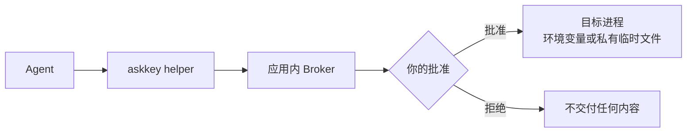

<p align="center">
  
</p>

<h1 align="center">Ask Key for Windows</h1>

<p align="center"><strong>面向 AI Agent 的 Windows 本地凭证管理器。</strong></p>

<p align="center">
  <a href="README.zh-CN.md">简体中文</a> · <a href="README.md">English</a>
</p>

请旨把凭证加密保存在你自己的电脑上。Agent 只能按名称和元数据发现凭证，然后向本地 Broker 请求访问；是否放行由你决定。获批的文本值会作为环境变量传给目标进程，文件值会作为短期私有文件交付。

请旨不会把库里的明文交给 Agent。获批的目标进程会收到值，并且和你运行的任何进程一样，可以复制或转发它。

支持 Windows 10 2004 及以上、Windows 11，x64。MIT 协议。构建未签名，SmartScreen 会提示。

> **macOS 上游：** 原始 macOS 应用和共享的产品/安全文档在 [sudoHG/AskKey](https://github.com/sudoHG/AskKey)。本仓库是非官方 Windows 移植版，不包含 macOS 源码；上游项目不对本构建负责。

## 安装

到 [Releases](https://github.com/A1mAssist/AskKey/releases) 下载 `AskKeySetup-<version>.exe` 并运行。一次 UAC 提示，把应用和 Windows Hello Guard 服务装进 `%ProgramFiles%\AskKey`。

运行前先校验下载。每个 Release 都带 `AskKey-<version>.sha256`：

```powershell
Get-FileHash -Algorithm SHA256 .\AskKeySetup-1.0.3.exe
```

把结果和 `AskKey-1.0.3.sha256` 里对应的一行比对；MSI 的校验值也在同一个文件里。

升级直接用新版安装包覆盖安装即可。Windows Installer 会原地替换应用和 Guard，已保存的凭据不受影响。

**高级安装。** `AskKey-win.msi` 只装应用，`AskKeyGuard-<version>.msi` 只装 Guard 服务，用于修复或脚本化部署——先装应用、再装 Guard，卸载时反过来。构建产物里的 `AskKey-win-Setup.exe` 是当前用户安装、不带 Guard，因此不对外发布：它用不了 Windows Hello 解锁。

## 首次启动

请旨会让你设置口令（默认开启），并在 Guard 服务可用时帮你登记 Windows Hello。口令是恢复路径，请另外保管好——它无法重置。

之后请旨会随 Windows 启动，只留在托盘，不弹窗口。左键单击托盘图标即可打开。vault 锁定时如果有 Agent 请求凭证，请旨会把解锁界面切到前台，而不是让请求悄悄失败。

解锁之后，在设置里选定的会话时长内（5 / 15 / 30 / 60 分钟），读取类审批不再重复询问。写入类审批每次都会问，因为它会把明文交给 Agent 或授予长期权限。

## Agent 接入

应用内置 Claude Code、Codex、Cursor 和 Grok CLI 的接入：打开 **Agent 接入**，勾选客户端并确认即可。它会添加请旨这个 MCP 服务、保留你原有的客户端配置，并在报告连接成功前校验 Helper 和 Broker。

任意 MCP stdio 客户端也可以手动配置：

```json
{
  "command": "C:\\Program Files\\AskKey\\current\\Helpers\\askkey.exe",
  "args": ["mcp"]
}
```

手动配置不会安装发现钩子，也不会执行应用内的连接检查；Broker 权限、审批和凭证交付保护仍然生效。

## 功能

- **查找凭证：** Agent 可以查询凭证名称、用途说明和变量映射，但拿不到明文值。
- **控制访问：** 每条凭证可以设为 **允许**、**每次询问** 或 **隐藏**。
- **审核写入：** 新建、修改、删除和整理凭证都可以要求批准；批准绑定到你看到的那份冻结内容。
- **值不出本机：** 查看或复制凭证值、查看冻结审批内容前，需要重新进行 Windows Hello 或 PIN 确认；普通管理操作在会话窗口内复用确认。
- **保护审批界面：** 会话锁定、断开或注销时，详细审批会自动收起，恢复后再显示。
- **快速创建：** 内置 API、SSH、GitHub App、云账号和数据库连接模板。

## 工作方式



Helper 只把本次请求选中的凭证交给目标命令；Broker 负责权限判断和审批队列。Agent 只能看到目标进程的输出或退出状态，看不到库里的凭证值。

## 安全模型

Agent 只被部分信任：它可以以你的 Windows 用户身份运行命令，但没有经过审批流程，不能拿到库里的凭证值。

- **高安全模式** 用你的口令包裹 vault key（PBKDF2-HMAC-SHA256，600,000 次迭代），并删除 DPAPI 副本。装了全机器 Guard 服务后，之后的启动可以用 Windows Hello 解锁；口令始终是恢复路径。启用这个模式只是重新包裹现有 key，不会轮换 key——切换前泄露到请旨之外的 key 或 DPAPI 副本依然有效。忘记口令就等于失去这个库。
- **默认模式** 用 Windows DPAPI（`CurrentUser`）包裹 vault key。它能保护静态文件，但任何以你的身份运行的程序都能解开同一个 key。
- **重新认证：** 查看或复制凭证值、查看冻结审批内容、批准 Agent 写入请求、把凭证权限提升为 **允许**，以及抹除本机数据，即使在管理会话内也需要重新进行 Windows Hello 或 PIN 确认。锁屏、断开和注销会结束会话。
- **进程内存边界：** 锁屏不会锁定凭证库，因为 Broker 仍需继续处理审批；`Lock()` 会清零 key，但以同一用户身份运行的进程可以读取进程内存。两种 key 模式都有这个限制。
- **完整性：** 发布包未签名，因此依赖内嵌的 Helper 清单，以及安装目录只允许管理员写入。真正的代码身份边界需要签名证书；签名构建要求 Host 和 Helper 使用同一发布者。
- Helper 必须和 Host 一起放在官方安装根目录内；被复制到其他位置的 Helper 会被拒绝。
- 调用方名称和用途是自报声明，不是经过认证的身份。获批的目标进程可以复制或转发交付给它的任何内容。**隐藏** 凭证不会出现在目录中，但这不能阻止已经收到值的命令继续转发。
- 请旨没有备份或恢复功能，请把原始凭证另外保存好。

## 卸载

从“应用和功能”卸载会移除应用和 Guard 服务。有三处是**有意保留**的：

- `%APPDATA%\AskKey` — 你的加密凭证库。删掉它等于丢掉所有凭证。
- `%ProgramData%\AskKey\Guard` — Guard 服务的 DPAPI 主密钥和各账户的 Windows Hello 注册。删掉它会让所有已注册账户的 Hello 解锁永久失效。详见 [docs/guard-service.md](docs/guard-service.md)。
- `%LOCALAPPDATA%\Microsoft\WindowsAppSDK\velopack.AskKey.png` — 非打包应用在任务栏使用的图标位图。

设置和 Broker 管道存放在 `%LOCALAPPDATA%\AskKey`。

## 从源码构建

构建、测试、打包和发布流程见 [docs/development.md](docs/development.md)。

## 许可证

MIT。见 [LICENSE](LICENSE) 和 [NOTICE](NOTICE)。
